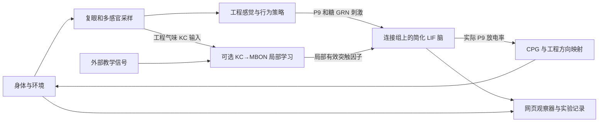

# Embodied Fly Lab · 具身果蝇实验场

**在 Windows 本地，把果蝇连接组、简化脑计算、三维身体和多感官环境接在一起，观察输入、放电、运动、反馈与局部学习。**

[下载 v0.1.0-alpha.2](https://github.com/koishiSaikou/embodied-fly-lab/releases/tag/v0.1.0-alpha.2) · [项目概述](docs/项目概述.md) · [文档导航](docs/文档导航.md) · [操作说明](docs/操作说明.md) · [AI 二次开发](docs/AI二次开发文档.md)

当前版本：**0.1.0-alpha.2 · Pre-release / Alpha Demo**。适合体验具身仿真、观察实际神经活动、开展局部回路干预和学习实验。这是第三方实验项目，未获 FlyWire 或其他上游背书；连接组规模不等于复原了真实果蝇的完整生理和行为。

## 本版新增

| 功能 | 可以做什么 |
| --- | --- |
| 实验保存与分享 | 保存数据、初始/最终配置和设置事件；指定目录另存 ZIP，导入朋友的实验；本地历史查看与条件重建 |
| 虚拟神经干预 | 按精确神经元 ID 或类型定时刺激、静默、取消，查看实际作用时间与目标放电 |
| 蘑菇体局部学习 | 对既有 KC→MBON 正连接进行可选局部 LTD；手动/糖接触教学、冻结、重置及学习因子导入 |
| 学习观察器 | 在统一模型时间上查看气味、KC 活动、教学、资格迹、因子和 MBON 响应，捕获前后窗口比较 |
| 历史只读图表 | 保存或导入后复用学习观察器，无需加载脑模型或启动身体仿真 |

局部学习默认关闭。默认 `KCg-m → MBON01` 对应 2,189 个候选 KC、2 个 MBON、1,865 条既有正连接；只改变所选边的临时因子，原始连接表、缓存和上游 LIF 方程不改。气味 KC 桥与教学标量是工程代理，目前没有学习出的 MBON→行为解码器，不能保证训练后自动改善觅食。

## 原有实验场

- FlyGym / NeuroMechFly 身体和 MuJoCo 物理：行走、转向、接触及右前足清洁程序。
- 左右复眼采样、可编辑觅食场、气味、水、光及温湿度等多感官代理输入。
- 实际放电栅格、群体/类型曲线、身份查询、部分真实骨架和静态脑区。
- 刺激、反馈、运动平滑、预测递质来源突触增益，以及独立的外置两类气味价值记忆。
- 桌面横屏工作台：图表可展开、折叠、拖动和缩放。

## 下载与运行

| 方式 | 适用情况 | 安装说明 |
| --- | --- | --- |
| [Windows 运行 ZIP](https://github.com/koishiSaikou/embodied-fly-lab/releases/download/v0.1.0-alpha.2/FlyWire-Windows-0.1.0-alpha.2.zip) | 希望直接在本地体验；含两套便携 Python、连接表、普通依赖和本版程序 | 包内 **开始使用.md** / [运行包说明](docs/交付包说明.md) |
| Git clone / Source code | 阅读、修改或二次开发；另行准备 Python、uv、依赖和连接表 | [源码安装说明](docs/源码安装说明.md) |

运行包仍需自行下载 **PyTorch CUDA wheel** 和 **imageio-ffmpeg wheel**，保留原名放进 `downloads`；链接、大小与 SHA256 见[下载说明](docs/下载说明.md)。仅身体模式免 PyTorch，仍需录像 wheel。无需 WSL，不覆盖系统 Python，不修改全局 PATH。

1. 将运行 ZIP 完整解压到纯英文/ASCII 路径，例如 `D:\FlyLab`，可带空格。
2. 补齐两个外部 wheel，双击 `Setup.cmd`，等待离线安装和安装器诊断完成。
3. 双击 `Start-Habitat.cmd`，等待脑初始化；打开控制台显示的实际网页地址。
4. 暂停后可调整参数；结束本轮点“结束并保存”，指定目录另存用“另存到…”。完全退出在控制台按 **Ctrl+C** 并等待保存结束；关闭网页不会停止服务。
5. `View-Records.cmd` 可单独查看历史、导入导出及已保存的学习图表。需要先完成身体/网页环境安装，但无需加载脑模型。

全脑模式需要兼容固定 CUDA wheel 的 **NVIDIA GPU/驱动**；建议预留至少 20 GB 磁盘空间。新版请解压到新目录，保留旧包和记录，不覆盖正在运行的目录。旧实验可查看，跨版本条件重放可能因版本/关键源码不匹配被拒绝。

## 做一轮局部学习观察

进入右侧“局部学习”，检查目标、启用模块并应用。先在无教学、冻结可塑性时积累完整窗口，再在“学习观察器”捕获前窗；进行教学后停止教学、再次冻结，在相近输入条件下捕获后窗。手动教学 0.5/1 是持续门控，需点 0 停止。

观察器会标明缺失/截断，拒绝把暂停改设置之前的旧读出当成新结果；前后比较检查条件差异，但不构成学习因果证据。实验包复现是从初始条件或最终设置/因子启动新轮，**不是完整脑和身体的中途检查点恢复**。

## 脑与身体如何连接

| 层 | 软件 / 数据 |
| --- | --- |
| 身体与物理 | FlyGym / NeuroMechFly 2.1.0、MuJoCo 3.9.0、hybrid CPG |
| 脑计算 | Eon fly-brain 的统一 LIF、PyTorch / CUDA 稀疏计算 |
| 连接和注释 | FlyWire FAFB v783、注释 v3.2.0；138,639 个节点、15,091,983 条带权神经元对记录 |
| 感觉与学习 | Python 工程策略、外置气味价值记忆、可选局部突触 LTD |
| 服务与界面 | FastAPI / Uvicorn / WebSocket、Three.js、Canvas、HTML/CSS/JavaScript |

三维脑图展示 16 个真实骨架、78 个静态脑区，是形态显示子集。静态脑区形状不表示活动，显示数量也不代表计算节点数量。更多架构细节见[项目详情](docs/项目详情.md)。

## 边界与验证

- 统一 LIF、感觉/运动工程规则和 CPG 不等于完整生物果蝇；没有完整 VNC、受体/递质浓度机制或全脑突触学习。
- 局部 LTD、外置气味记忆相互独立；当前教学代理不重建天然 DAN 释放，局部变化不保证行为改善。
- 初始保存导入功能做过隔离短程实跑；神经干预、局部学习与观察器做过小规模 CPU、数据及逻辑检查。各阶段证据仅覆盖当时范围；本次打包不新增安装、全脑 CUDA、身体、浏览器、性能或长时验收。
- 模型可能慢于实时；长时内存/磁盘保护仍暂缓，记录会持续增长。
- 当前面向 Windows x64、NVIDIA 全脑模式和桌面横屏，其他平台/硬件未普遍验证。

详见[已知限制](docs/已知限制.md)及[测试版更新说明](docs/测试版更新说明.md)。

## 说明文档

| 文档 | 内容 |
| --- | --- |
| [文档导航](docs/文档导航.md) | 所有运行、开发和许可入口 |
| [操作说明](docs/操作说明.md) / [启动与停止](docs/启动与停止说明.md) | 安装后日常使用 |
| [保存与分享](docs/实验保存与分享说明.md) / [实验包格式](docs/实验包格式.md) | 保存、导入、条件重建边界 |
| [虚拟神经干预](docs/虚拟神经干预说明.md) | 目标选择、刺激和静默 |
| [蘑菇体局部学习](docs/蘑菇体局部学习说明.md) / [学习观察器](docs/蘑菇体学习观察器说明.md) | 教学、冻结、实际读出与前后比较 |
| [项目详情](docs/项目详情.md) / [AI 二次开发文档](docs/AI二次开发文档.md) | 架构、文件职责和开发合同 |
| [版本记录](版本与更新记录.md) | 当前与历史版本变化 |

修改前先读 [AI协作约定.md](AI协作约定.md)。问题请到 [Issues](https://github.com/koishiSaikou/embodied-fly-lab/issues)，附版本、Windows/显卡、启动方式、复现步骤和错误片段，先移除敏感信息。

## 许可与致谢

自行编写的程序和原创说明为 **GPL-3.0-or-later**；第三方代码、资产和数据保留各自许可。FlyWire 数据含 **CC BY-NC 4.0** 条件，不能把整个混合包宣传为可商用，也不向 GPL 代码额外施加非商业限制。

感谢 FlyWire、FlyGym / NeuroMechFly、Eon fly-brain 及相关作者。见[许可说明](许可说明.md)、[第三方来源](第三方许可与来源.md)、[数据使用与署名](数据使用与署名.md)、[引用文献](引用文献.md)及[运行包许可与来源](docs/运行包许可与来源.md)。第三方实验 Demo，无上游背书或任何担保。
