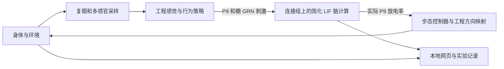

# Embodied Fly Lab · 具身果蝇实验场

**在 Windows 本地，把果蝇连接组、简化脑计算、三维身体与多感官环境接在一起，观察“输入—放电—运动—反馈”的过程。**

[下载测试版](https://github.com/koishiSaikou/embodied-fly-lab/releases/tag/v0.1.0-alpha.1) · [项目概述](docs/项目概述.md) · [文档导航](docs/文档导航.md) · [操作说明](docs/操作说明.md) · [AI 二次开发](docs/AI二次开发文档.md)

当前版本：**0.1.0-alpha.1 · Pre-release / Alpha Demo**。这是第三方学习与实验项目，适合体验连接组驱动的身体控制、观察脑活动和修改感觉/行为策略。它不是 FlyWire 官方产品；连接数据覆盖广，并不等于已经复原真实果蝇的全部脑功能、生理和行为。

## 可以体验什么

| 方面 | 当前内容 |
| --- | --- |
| 三维身体 | FlyGym / NeuroMechFly 身体与 MuJoCo 物理；观察行走、转向、接触及右前足清洁程序 |
| 感官与环境 | 左右复眼采样、气味、食物接触、光、水、危险及温湿度等工程代理输入；可编辑觅食场 |
| 脑活动 | 实际放电栅格、群体/类型曲线、神经元身份查询、少量真实骨架和静态脑区模板 |
| 实验参数 | 刺激强度、脑到身体反馈、运动平滑及按预测递质来源分组的突触增益 |
| 行为探索 | 探索、觅食、寻水、环境反应及外置的两类气味价值记忆 |
| 网页工作台 | 本地浏览器操作；桌面横屏布局，图表可以展开、折叠、移动和缩放 |
| 实验记录 | 暂停、结束并保存、手动新开一轮；记录模型时间、感觉、运动与神经活动 |

## 先选下载方式

| 你想做什么 | 选择 | 安装入口 |
| --- | --- | --- |
| 先运行体验 | Release 附件 **FlyWire-Windows-0.1.0-alpha.1.zip**，约 403 MB | 包内 **开始使用.md** / [运行包说明](docs/交付包说明.md) |
| 阅读或修改源码 | Git clone、仓库 Code → Download ZIP，或 Release 的 Source code | [源码安装说明](docs/源码安装说明.md) |

Windows 运行包已带两套项目专用 Python、连接表和大部分依赖。**仍需另外下载 PyTorch CUDA wheel（约 2.75 GB）与 imageio-ffmpeg wheel（约 31 MB）**，原名放入解压目录 `downloads`；直链、准确大小和 SHA256 见[下载说明](docs/下载说明.md)。补齐后安装使用本地文件。

源码归档包含程序和小型资源，不包含解释器、普通依赖 wheel、大连接表、个人实验及权重缓存。不要把 GitHub 自动生成的 Source code 归档当作已准备好环境的运行包。

## Windows 运行包快速开始

1. 从[测试版页面](https://github.com/koishiSaikou/embodied-fly-lab/releases/tag/v0.1.0-alpha.1)下载运行 ZIP，完整解压到纯英文/ASCII 路径，例如 `D:\FlyLab`，可带空格。
2. 按[下载说明](docs/下载说明.md)把两个外部 wheel 放入 `downloads`。
3. 双击 **Setup.cmd**，等待校验、离线安装与安装器诊断结束。
4. 双击 **Start-Habitat.cmd**，等待脑初始化；在自动打开的网页操作，实际端口见控制台。
5. 网页可暂停或结束并保存；完全停止时在对应控制台按 **Ctrl+C**，等待保存与子进程退出。关闭网页不会关闭后端。

系统要求：Windows x64（Intel/AMD）、桌面横屏；全脑模式需要兼容固定 CUDA wheel 的 NVIDIA GPU 与驱动。建议预留至少 20 GB 磁盘空间。随包 Python 和新环境均在项目内，**不覆盖系统 Python，不修改全局 PATH**；无需 WSL、Node.js 或自行安装 CUDA Toolkit。源码安装另需已有 CPython 3.13 / 3.12 和便携 uv。

只看身体可在补齐录像 wheel 后运行 `Setup.cmd --body-only`，再双击 `Start-Body.cmd`；此时无需 PyTorch 或 NVIDIA GPU。更多选项见[启动与停止](docs/启动与停止说明.md)。

## 脑与身体如何连接

| 层 | 使用的软件 / 数据 |
| --- | --- |
| 身体与物理 | FlyGym / NeuroMechFly 2.1.0、MuJoCo 3.9.0、hybrid CPG 步态控制器 |
| 脑计算 | Eon fly-brain 的统一 LIF 实现、PyTorch / CUDA 稀疏计算 |
| 连接和注释 | FlyWire FAFB v783，注释 v3.2.0；138,639 个节点、15,091,983 条带权神经元对记录 |
| 感觉与行为 | Python 工程策略、代理场和外置气味价值记忆 |
| 服务与界面 | FastAPI / Uvicorn / WebSocket，Three.js、HTML/CSS/JavaScript、Canvas |

完整时钟、文件与数据说明见[项目详情](docs/项目详情.md)。三维脑图当前展示 **16 个真实骨架、78 个静态脑区**；这是显示子集，不是参与计算的节点数量。静态形态不代替真实活动信号。

## 已知边界

- 脑使用统一的简化 LIF 动力学；没有完整类型特异生理、受体/递质浓度动力学、完整腹神经索或全脑突触可塑性。
- 感觉到动作包含工程规则。气味价值学习在外置策略层，不代表全脑模型自己学会了这些行为。
- 速度可能低于现实时间；网页流畅程度、显存占用与脑仿真速度不能混为一谈。
- 长时间运行的内存/磁盘保护仍暂缓，记录会增长。本版本没有新增安装、仿真、GPU、性能或长时测试保证。
- 当前面向 Windows x64 和桌面横屏；其他系统、GPU 和驱动组合没有普遍兼容承诺。

详见[已知限制](docs/已知限制.md)。

## 说明文档

| 文档 | 适合阅读的人 |
| --- | --- |
| [项目概述](docs/项目概述.md) | 想先理解项目做什么、模型如何工作的读者 |
| [文档导航](docs/文档导航.md) | 想按运行、操作、开发、许可查找说明的读者 |
| [运行包说明](docs/交付包说明.md) / [源码安装](docs/源码安装说明.md) | 首次安装者 |
| [日常操作](docs/操作说明.md) / [工作台布局](docs/工作台布局说明.md) | 想了解界面与调整项的使用者 |
| [项目详情](docs/项目详情.md) / [AI 二次开发文档](docs/AI二次开发文档.md) | 开发者和 AI 编程助手 |
| [异常恢复](docs/异常处理与恢复说明.md) / [版本记录](版本与更新记录.md) | 排查问题、了解版本变化的使用者 |

修改前请读 [AI协作约定.md](AI协作约定.md)。问题或建议可在 [Issues](https://github.com/koishiSaikou/embodied-fly-lab/issues) 提交，尽量提供版本、Windows/显卡信息、启动方式、复现步骤和相关错误片段；请先移除个人路径与敏感信息。

## 许可与致谢

本项目自行编写的程序与原创说明采用 **GPL-3.0-or-later**；第三方代码和数据保留各自许可。FlyWire 相关数据含 **CC BY-NC 4.0** 条件，不能将整个混合数据包视为可自由商用；这些条件不向 GPL 程序追加非商业限制。

感谢 FlyWire、FlyGym / NeuroMechFly、Eon fly-brain 及相关数据、软件和论文作者。具体署名、来源与使用条件见[许可说明](许可说明.md)、[第三方许可与来源](第三方许可与来源.md)、[数据使用与署名](数据使用与署名.md)、[引用文献](引用文献.md)和[运行包许可与来源](docs/运行包许可与来源.md)。这是第三方实验 Demo，未获上游背书，无任何担保。
