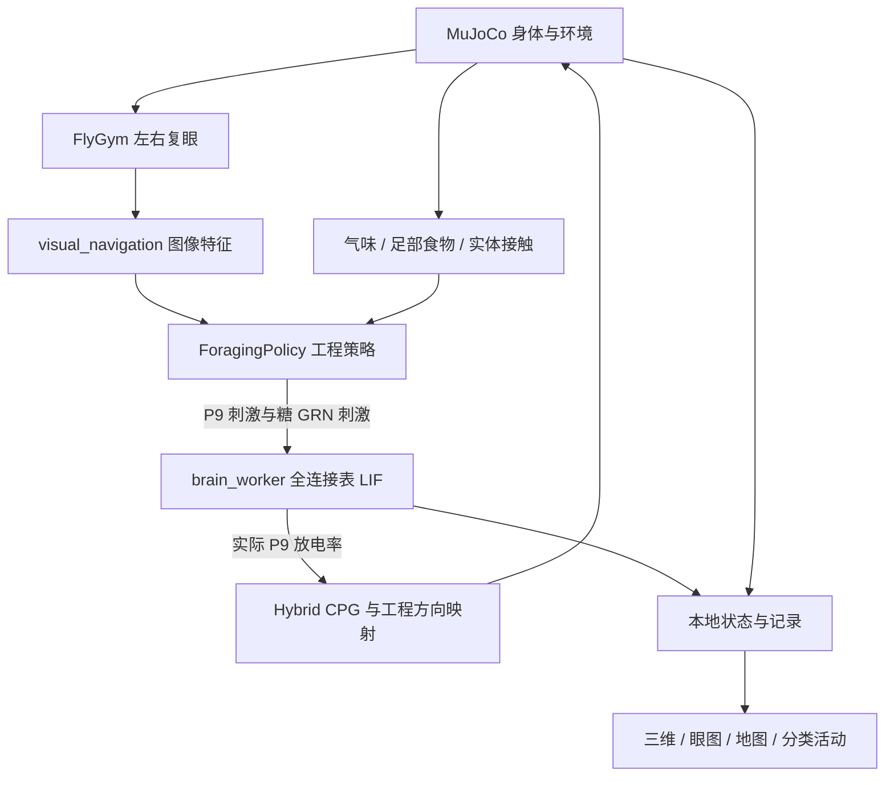

# 项目详情

## 项目是什么

本项目把公开的果蝇脑连接组、简化神经计算、物理身体和感觉环境接到同一个本地实验场，支持观察实际放电、身体运动和工程控制反馈。它是可以修改源码的研究/学习演示，不是一个已经复原生物果蝇全部功能的模型。

当前没有训练得到的“大脑权重模型”。脑连接来自连接组数据；`weight_coo.pkl`、`weight_csr.pkl` 是第一次运行生成的稀疏矩阵缓存，不是学习得到的参数。交付 ZIP 不含这两个可重建的大缓存。

## 主要技术

| 层 | 软件 / 文件 | 用途 |
| --- | --- | --- |
| 身体 | FlyGym / NeuroMechFly 2.1.0，MuJoCo 3.9.0 | 关节、接触、黏附、实体碰撞、眼部相机 |
| 步态 | 上游 hybrid CPG controller | 把驱动幅度转成六足关节动作，近似腹神经索的运动控制 |
| 脑 | Eon fly-brain 的 PyTorch LIF 实现 | CUDA 稀疏连接计算、膜电位、延迟突触、不应期、Poisson 刺激 |
| 连接 / 注释 | FlyWire FAFB v783，官方注释 v3.2.0 | 神经元 ID、连接、类型、侧别、递质信息 |
| 感觉与行为 | 本地 Python 工程策略 | 复眼风险、气味趋向、接触脱困、糖味停留 |
| 服务 | FastAPI、Uvicorn、WebSocket | 回环网页服务与实际状态、命令传递 |
| 前端 | 本地 Three.js、HTML/CSS/JavaScript、Canvas | 身体三维、复眼图、骨架、地图、分类脑活动 |
| 部署 | 两个本地 Python 环境 + uv 离线 wheel 安装 | 避免修改系统 Python 与全局环境 |

正常运行不需要 Node、数据库、云 API、WSL、CUDA Toolkit 或训练平台。浏览器脚本、Three.js、默认身体网格均随包提供。

本机网页现可实时调节 P9 两通道输入增益、共同基础刺激、糖 GRN 输入增益、脑到身体反馈增益/开关以及运动读出平滑时间；这些基础项保持原连接权重。另有六类递质来源突触增益，按发出信号神经元的 `top_nt` 预测缩放本轮有效权重，保留原权重正负号，未知组固定 1 倍；六项均为 1 时恢复原始张量。参数变更记录在实验日志中，LIF 方程和原始文件不改。活动显示窗口、栅格行数和刷新间隔只改变浏览器显示。操作和范围见 [操作说明](操作说明.md)。现有交付压缩包按用户要求不自动重建。

## 架构和时钟

身体主进程使用 Python 3.13，脑工作进程使用 Python 3.12，经标准输入/输出的 JSON lines 通信。脑状态跨步保留。每次脑推进 20 ms，身体推进等长模型时间；CPG 约 2 kHz、物理约 10 kHz，脑积分步长 0.1 ms。视觉每 0.04 模型秒采样，控制读取最近一帧。模型时钟、现实等待时间、浏览器动画帧率分开计量。

## 脑数据规模

| 项目 | 当前数值 |
| --- | ---: |
| 模型节点 | 138,639 |
| 带权神经元对 / 连接表行 | 15,091,983 |
| 行权重所计的原始突触接触总和 | 54,492,922 |
| 有注释行 | 138,625 |
| 有具体类型名 | 137,147（98.92%） |
| 具体类型未知 | 1,492 |
| 注释行缺失 | 14 |
| 已命名具体类型 | 8,845 |
| 已知大类 | 10，另列大类未知 |
| 网页已下载骨架 | 16 |
| 静态配准脑区模板 | 78 |

所有连接表节点参与同一模型的计算，没有为了网页只留下 P9。节点未放电不代表没有载入。骨架显示是小子集，不能用显示的骨架数量估计实际计算规模。

## 已实现的闭环

本机默认场景现为可编辑的综合觅食场（七区起步、最多 24 个元素）。区域在真实 MuJoCo 地面几何中预分配，编辑不重置身体或脑；三维、地图和实际复眼同步显示。糖/果味/排斥气味、湿度、亮度与温度为在实际触角位置采样的代理场，甜/苦/水接触使用实际足部几何位置。新增反馈经工程策略进入 P9，糖味继续使用已接入的糖 GRN；详见 [场景与多感官说明](场景与多感官说明.md)。没有流体、热传导、照度求解或新的生物感觉神经通路。

- **视觉**：MuJoCo 左右眼 → FlyGym 鱼眼及每眼 721 个小眼采样 → 前向窗口对比度、暗区占据和正向变化 → 工程风险与避让。图像处理器不接收物体坐标、分割或深度，不是完整视叶神经通路。
- **气味**：在真实触角位置采样静态高斯气味场；工程策略由左右差和浓度计算趋向与减速。没有嗅觉受体神经元到高级中枢的完整模拟。
- **接触**：读取实际实体接触，必要时工程策略后退、转向脱困。几何近距探针默认关闭，可作为另外的对照打开。
- **糖味**：足部接触食物区时刺激上游定义的 21 个糖 GRN，并触发工程停留规则；不是直接证明真实摄食。
- **运动**：当前主要读取两只 P9/DNp09 的实际放电率，平滑后决定 CPG 幅度，工程反射决定方向与停走。

P9 控制通道 A 的 ID 为 `720575940627652358`，B 为 `720575940635872101`。注释的解剖侧别分别为右、左，与上游旧注释的左右命名相反，因此本项目保留 A/B 顺序，不擅自交换通道。

## 分类脑活动

前端从实际采集的事件按模型编号查表归类，展示最近最多 1 秒模型时间。既能看群体总放电率，也能按群体全部节点数归一化；分母包含静默节点。类型查询覆盖所有已命名类型，未知项保留。事件数与同窗原始模型计数核对；缓冲丢失时标注统计下限。

分类不改变神经计算，也不能用“某类放电了”直接推断它已执行某个生物任务。三维脑区模板不分配推测的动态信号。

## 尚未实现

脑模型没有突触可塑性、内部奖励学习或类型特异膜参数；本机外置气味价值学习另行记录。也没有完整神经调质/受体模型、全腹神经索、全部感觉通路或已验证的生物行为策略。递质预测和文献注释已导入，但没有据此改写原权重的兴奋/抑制符号。

当前递质旋钮只是按预测来源组缩放有效连接强度，不是递质浓度、受体响应、释放/回收或真实调质通路的实现。多巴胺增益不等于奖励学习；一组预测递质内的原正负连接也可能混合，面板按实际底表显示并保留它们。

原始连接组也不是每种神经元全部生理参数的测量表。当前统一 LIF 模型是有用的近似，不能把连线齐全等同于功能复原齐全。

## 固定来源

- [FlyGym](https://github.com/NeLy-EPFL/flygym)，commit `38c8ec61034cd59bc5ba0de20688d4a3c0000d60`，Apache-2.0，源代码及默认资产随包保留。
- [Eon fly-brain](https://github.com/eonsystemspbc/fly-brain)，commit `a3db62f9436074e485c0278290c2164ed6150808`，GPL-2.0-or-later；本包仅包含所调用的 PyTorch/benchmark 代码与对应数据，不是其全部多后端基准工程。
- [官方注释](https://github.com/flyconnectome/flywire_annotations)，v3.2.0，commit `a83b2776d60d5764cef36b927f5f9679c16c47a2`，对应 v783 ID。
- 骨架、脑区数据的逐项来源和校验见 `web/morphology_sources.json`；连接/注释表的校验见 `brain-model/data/annotation_report.json`。
- 分类索引的源数据校验在 `web/activity_catalog.json`，依赖及运行时清单在 `requirements`、`licenses` 和 `bundle-manifest.json`。

## 扩展行为与外置气味学习

本机现提供综合探索、优先觅食、寻水、明暗偏好、温度趋向、逆风追踪、局部搜索、视觉惊逃、休息和右前足清洁。右侧“行为”分类可选择模式、开关与参数，设置饥饿/口渴/疲劳/清洁负荷，观察两类气味的价值记忆。新增凉区/冰块提供降温代理。

学习发生在外置工程行为层，用实际气味痕迹及甜/苦味反馈更新两个气味价值，再影响 P9 输入；全脑 LIF 与原连接权重不变。清洁通过实际关节执行器完成。详见 [行为与感官驱动说明](行为与感官驱动说明.md)。运行中的旧进程需先保存再重启，当前交付包不自动重建。
